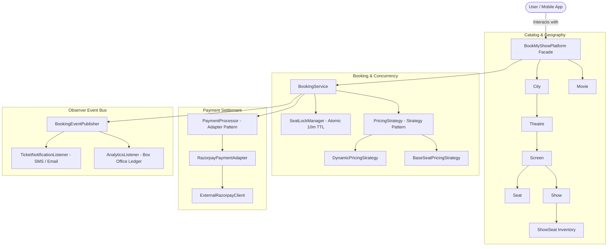

# BookMyShow Movie Ticket Booking System — Low-Level Design (LLD)

[](https://openjdk.org/projects/jdk/21/)
[](pom.xml)
[](src/test/java/com/bookmyshow)
[](BookMyShowSchema.md)

A production-grade, object-oriented Low-Level Design (LLD) for **BookMyShow** in Java 21 LTS adhering to clean architecture, SOLID principles, and Gang of Four (GoF) design patterns.

---

## 1. System Requirements & Domain Feature Matrix

| # | Requirement | Implementation Details | Design Pattern / Component |
| :---: | :--- | :--- | :--- |
| **1** | **Multi-City & Multi-Theatre** | Geographic hierarchy: `City` $\to$ `List<Theatre>` $\to$ `List<Screen>`. | Domain Modeling |
| **2** | **Screen & Seat Categorization** | Screens contain multiple categorized seats (`PLATINUM`, `GOLD`, `SILVER`). | `Seat`, `SeatType` |
| **3** | **Show Scheduling & Features** | Shows mapped to Movies, Screens, timings, and supported features (`2D`, `3D`, `DOLBY_IMAX`, `DOLBY_VISION`, `4DX`, `DOLBY_ATMOS`). | `Show`, `Feature` validation |
| **4** | **Dynamic Day & Time Pricing** | Pricing calculated dynamically by seat type, weekend multiplier, prime-time multiplier, and format features. | `PricingStrategy`, `DynamicPricingStrategy` (Strategy Pattern) |
| **5** | **Multi-Seat Atomic Booking** | Concurrent seat selection with 10-minute TTL and transactional all-or-nothing rollback. | `SeatLockManager` (Thread-Safe Concurrency) |
| **6** | **Payment Gateway Integration** | Razorpay payment integration converting Rupees to Paise with order & signature verification. | `PaymentProcessor`, `RazorpayPaymentAdapter` (Adapter Pattern) |
| **7** | **Event-Driven Notifications** | Real-time event publisher broadcasting booking confirmations and cancellations. | `BookingEventPublisher`, `BookingEventListener` (Observer Pattern) |
| **8** | **Unified Entry Point** | Simplified platform facade orchestrating catalog search, booking, payment, and cancellation. | `BookMyShowPlatform` (Facade Pattern) |

---

## 2. Architecture Diagram



---

## 3. Test Verification
```bash
mvn clean test
```
- **12 unit & integration tests passing with 100% success**.
- High concurrency test verifying 20 threads competing for contested seats with zero double-booking.
